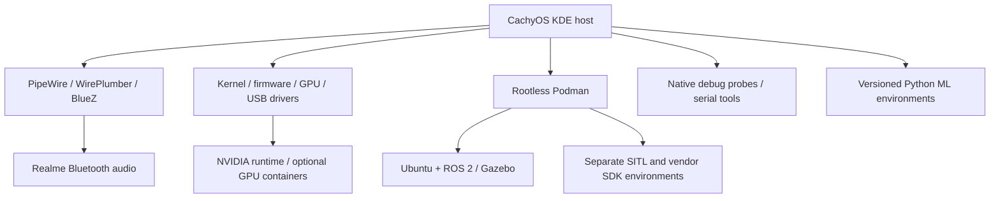

# Marine & Space Robotics Linux Workstation

**Recommendation: CachyOS Desktop with KDE Plasma (Wayland), Btrfs, the default CachyOS kernel and an LTS fallback.**

Prepared for Anandhu on **10 November 2026**. This is a fresh-install playbook for an experienced Linux developer transitioning into embedded engineering, robotics and AI/ML. The recommendation prioritizes responsiveness, Bluetooth audio and access to current hardware support, with reproducible project environments.

CachyOS is already running on this laptop, but the recommendation is made for a **fresh installation with no preference for the existing OS**. Its current presence is compatibility evidence, not a reason to select it. There is no controlled benchmark here proving CachyOS is faster than every alternative. [Read the decision and tradeoffs](docs/01-distro-decision.md), including the dedicated [CachyOS versus EndeavourOS comparison](docs/13-cachyos-vs-endeavouros.md).

## Your hardware

| Item | Observed locally |
|---|---|
| Laptop | ASUS TUF Gaming A17 FA706IC |
| CPU | Ryzen 7 4800H, 8 cores / 16 threads |
| RAM | 16 GB nominal, about 15 GiB usable |
| Graphics | AMD integrated graphics + RTX 3050 Laptop, **4 GB VRAM** |
| Wireless | MediaTek MT7921 Wi-Fi; USB Bluetooth device `13d3:3563` |
| Audio | Your **realme Buds Wireless 5 ANC** neckband |
| Storage | Two NVMe SSDs: about 465.8 GiB with Windows partitions and 476.9 GiB with Linux |
| Existing Linux | CachyOS, KDE Wayland, Btrfs, GRUB, main + LTS kernels |

The Linux filesystem was about 80% used, with 100 GiB available. Capacity planning matters. This guide budgets only the Linux SSD; it does not assume the Windows SSD is available for reuse. Device names can change between boots. No disk serial numbers, headset addresses, credentials or raw system logs are committed.

## Read in this order

For a shorter execution sequence, start with [the first-weekend plan](docs/15-first-weekend.md) and copy [the acceptance record](templates/acceptance-record.md).

1. [Master TODO checklist](TODO.md) — progress from backup to a working workstation.
2. [Distro decision](docs/01-distro-decision.md) — comparison, rationale and alternatives.
3. [Fresh installation](docs/02-fresh-install.md) — backup, Windows preservation, partition choices and first boot.
4. [Performance & ASUS/NVIDIA](docs/03-performance-and-hardware.md) — power, memory, graphics and benchmarks.
5. [Bluetooth audio](docs/04-bluetooth-audio.md) — Realme pairing, codecs, calls and recovery.
6. [Application catalogue](docs/05-applications.md) — what to install, where and when.
7. [Containers & ROS 2](docs/06-containers-and-ros.md) — working CLI lab, GUI path, DDS and USB.
8. [Embedded engineering](docs/07-embedded.md) — cross compilation, debug probes, serial and RTOS.
9. [AI/ML](docs/08-ai-ml.md) — Python isolation, CUDA validation and 4 GB VRAM limits.
10. [Marine/space learning path](docs/09-learning-path.md) — practical portfolio milestones.
11. [Maintenance & recovery](docs/10-maintenance-and-recovery.md) — updates, snapshots, backups and troubleshooting.
12. [Research sources](docs/11-sources.md) and [validation record](docs/12-validation.md).
13. [CachyOS versus EndeavourOS](docs/13-cachyos-vs-endeavouros.md) — a detailed fresh-install comparison and how the guide changes if you choose EndeavourOS.
14. [EndeavourOS installation path](docs/14-endeavouros-install.md) — alternative host setup, LTS/NVIDIA checks, zram and recovery.
15. [First sensor lab](docs/16-first-sensor-lab.md) — runnable Python sensor example, ROS recording and replay without hardware.
16. [Robot networking and CAN](docs/17-robot-networking-and-can.md) — dedicated Ethernet, clock checks and a virtual CAN exercise.
17. [Offline use and environment backup](docs/18-offline-and-environment-backup.md) — preserve images, project data and volumes; rehearse working without internet.
18. [Temperature-monitor mini-project](docs/19-temperature-monitor-project.md) — threshold alerts, hysteresis, missing-data detection and repeatable tests.

## Included helpers

Run commands from the repository root unless a section says otherwise.

```bash
# Read-only inspection; review output before sharing it.
bash scripts/doctor.sh

# Prints an installation command; does not install anything.
bash scripts/packages.sh core

# Optional: deliberately apply a package group after reading the guide.
bash scripts/packages.sh core --apply

# Build a small ROS 2 Jazzy learning environment.
podman build -t localhost/robotics-jazzy -f containers/ros/Containerfile .
bash scripts/ros.sh ros2 run demo_nodes_cpp talker
```

The package helper never partitions disks, changes bootloaders, selects GPU drivers or enables services. ROS uses a writable `workspaces/ros` directory, preserved between disposable containers. **Host setup, flash operations and headset/suspend testing remain checklist tasks**; publishing these docs does not perform them.

## Architecture



Containers isolate userspace dependencies. They still depend on the host kernel, USB permissions, networking and GPU driver. Keep audio on the host. Use a microcontroller or RTOS for deterministic control loops; a responsive laptop desktop is not a real-time robot controller.
